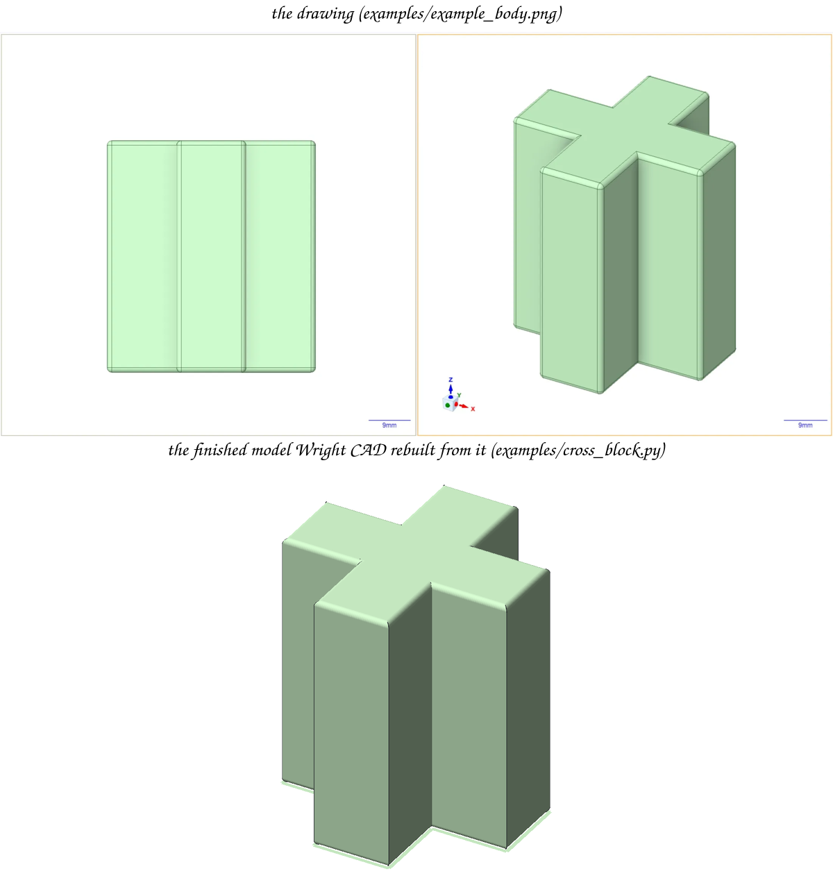
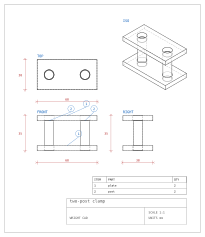

# Wright CAD

<p align="center">
  
</p>

A CAD whose primary user is an **AI agent**.

> The logo is the "hello world" of this CAD: three spheres, a cylinder and a
> couple of boxes, assembled by a parametric program — drawn as an SVG from the
> same primitives the engine tessellates. See
> `examples/draw_snowman_family.py` for the living version.

The architecture inverts the usual GUI-first design: the headless core and
its command bus are the product; the human-facing viewer is just another
client — as is the Python client an agent drives. Mesh import closes the other
direction: an STL, OBJ or 3MF file becomes an ordinary editable solid, so an
agent handed an existing part can participate instead of starting over. DXF
and SVG export close the drawing loop: sketches and their closed profiles come
back out in sketch-local millimeters for CAD, laser cutters and CAM. STEP
export hands the solids themselves to another CAD kernel as an explicit
faceted B-rep, without pretending the tessellation is analytic geometry.
Assemblies place reusable parts with mates and interference checks, and
`export_drawing` turns any scene into a dimensioned multi-view SVG or DXF
sheet with hidden lines, balloons and a bill of materials.

```
┌───────────────┐   JSON-RPC (stdio/TCP)   ┌───────────────┐   ┌──────────────────┐
│ agent /       │ ───────────────────────► │ wright server │ ─►│ wright-core      │
│ python /      │ ◄─────────────────────── │ (transport)   │   │ documents        │
│ any language  │                          └───────────────┘   │ entities         │
└───────────────┘                                              │ history / undo   │
                                                               │ tessellation     │
┌───────────────┐          same bus (TCP)                      │ booleans         │
│ wright-view   │ ───────────────────────────► get_scene ─────►│ fillet / chamfer │
│ (wgpu, dumb)  │  pulls snapshots; owns no document state     └──────────────────┘
└───────────────┘
```

## Showcase: a drawing in, a parametric part out

The agent is handed a picture — here `examples/example_body.png`, a front and
a 3/4 view of a cross block — and writes `examples/cross_block.py`, which
rebuilds the part as a parametric program:



The dimensions are read off the drawing rather than guessed: its 9 mm scale
bar gives ~12.4 px/mm, and its front panel is 553 × 614 px, so the body is
45 × 45 mm in plan, 15 mm arms and 50 mm tall. The camera was fitted on a
sharp baseline so the silhouette comparison stays unambiguous (0.99 IoU), and
that baseline's front view matches the drawing's aspect to ~0.1%
(0.898 vs 0.899). The script then rounds the part the way the drawing does —
a 1 mm `fillet` on the top and bottom rims, driven by the `round_r` knob. The
drawing's plan corners are sharp, so the twelve vertical edges are
deliberately left alone. The 3/4 view above is that finished part; here it is
on its own:


`fillet` reshapes the solid in place, so the entity id, camera and STL/3MF
export still apply. Turning `height` down to 30 mm replays the sketch, the
extrude and both rim fillets, so the rounding follows the new geometry.

The loop: **read** the two views → **author** the parametric program
(`span`/`arm`/`height`, twelve sketch lines, `extrude`) → **check** the
silhouette with `render_offscreen` from the drawing's camera → **finish** the
rims with `fillet` and a normals filter (`{normals:[[0,0,1]]}` top,
`{normals:[[0,0,-1]]}` bottom; `chamfer` shares the machinery, but this
drawing has rounds, not bevels) → **deliver** STL/3MF for the slicer and the
matching `.wcad` so the part reopens with its knobs intact.

The artifacts live in `examples/cross_block/`: `iso.png`, `front.png`,
`cross_block.stl`, `cross_block.3mf` and `cross_block.wcad` (the sharp
baseline), plus `rounded.png`, `cross_block_rounded.stl`,
`cross_block_rounded.3mf` and `cross_block_rounded.wcad` (the finished part),
and `compare.png` (the drawing above that part).
`.venv/bin/python examples/cross_block.py` regenerates them.

## Layout

| Path | What it is |
|---|---|
| `crates/protocol` | Wire types: commands, results, meshes (serde/JSON) |
| `crates/core` | Headless engine: documents, parameters, sketches, booleans, fillets, persistence, assemblies, DXF/SVG/STEP drawings and sheets, deterministic rendering |
| `crates/server` | `wright` binary — line-delimited JSON-RPC on stdio or TCP |
| `crates/viewer` | `wright-view` — wgpu renderer, talks only the bus |
| `python/wright` | Dependency-free sync Python client (the agent API) and MCP server |
| `examples/` | Agent-facing demos; `examples/cross_block/` is the committed showcase |
| `index.html`, `fonts/`, `logo.svg` | Static project page (GitHub Pages), with self-hosted fonts |

## Design rules

1. **The command bus is the only API.** No side channel exists between the
   viewer and the engine; every client gets the same, scriptable surface.
2. **Deterministic.** Integer ids, stable tessellation, replayable command
   sequences — tests and agents can rely on exact repetition.
3. **Agent ergonomics are features.** Errors carry recovery hints
   ("run create_document first, or list_documents"); results are
   self-contained (a new entity arrives with its full mesh — no second
   round trip); ids are small and predictable.
4. **The renderer is dumb.** It draws buffers; it owns no logic.

## Protocol (v1)

Line-delimited JSON-RPC 2.0, one request/response per line:

```json
{"jsonrpc":"2.0","id":1,"method":"add_box","params":{"doc":1,"name":"base","center":[0,0,"wall/2"],"size":[80,40,"wall*2"]}}
{"jsonrpc":"2.0","id":1,"result":{"entity_created":{"doc":1,"entity":1,"mesh":{...}}}}
```

Commands, grouped by intent:

- **Documents**: `initialize`, `list_documents`, `create_document`,
  `close_document`
- **Primitives**: `add_box`, `add_sphere`, `add_cylinder`
- **Modelling**: `boolean`, `transform`, `set_color`, `delete`, `fillet`,
  `chamfer`
- **Shape leverage**: `linear_pattern`, `circular_pattern`, `mirror`,
  `shell`, `hole`, `sweep`, `loft`, `thread`
- **Assemblies**: `import_part`, `add_part`, `add_instance`, `add_connector`,
  `move_instance`, `mate`, `bill_of_materials`, `check_interference`
- **Parameters**: `set_parameter`, `remove_parameter`, `get_parameters`
- **Sketches and solids**: `add_sketch`, `add_sketch_line`,
  `add_sketch_circle`, `add_sketch_arc`, `add_sketch_spline`, `constrain`,
  `remove_constraint`, `move_sketch_point`, `delete_sketch_element`,
  `trim_sketch`, `extend_sketch`, `offset_sketch`, `extrude`, `revolve`
- **Interoperability**: `import_mesh` (STL/OBJ/3MF → solid), `add_mesh` (raw
  triangles; the baked program step import records)
- **Queries and I/O**: `get_scene`, `get_program`, `pick`, `validate`,
  `diff_scene`, `export_stl`, `export_3mf`, `export_step`, `export_dxf`,
  `export_svg`, `export_drawing`, `render_offscreen`, `save_document`,
  `open_document`
- **History**: `undo`, `redo`

`get_program` returns the program, the parameters and any embedded authoring
source — the complete handoff for the script-as-source workflow.

`fillet{entity,radius,edges?}` and `chamfer{entity,distance,edges?}` reshape a
solid **in place** (same id, name, color, transform) and replay with the
program. `edges` is a geometric filter rather than an index — an AND of
`direction` (+`angle_tol_deg`), `near` (+`near_radius`), `normals` (one face
normal = all its edges, two = the edge between them) and `convex` — so "the
vertical corners" or "the top rim" keeps its meaning when a parameter moves
the geometry. Omit it to treat every sharp edge; `min_angle_deg` (default 30)
separates real edges from tessellation seams.

`pick{doc,ray:{origin,direction},tolerance?}` casts a world-space ray at the
document's solids and answers
`{hit:{entity,name,distance,point,normal,face,edge?}}` — or `hit:null` when
nothing is under the ray (a valid answer, not an error). The selectors are
ready to use: `face` carries the
`{entity,normal,near}` body of `add_sketch`'s face plane (pass it straight to
the Python client's `plane=`, or wrap it as `plane:{"face":…}` on the raw
bus), and `edge` is exactly the `edges` filter `fillet`/`chamfer` take
(`{direction,near,near_radius}`), present when the hit lands within
`tolerance` mm of a sharp edge (default: 1% of the entity's bbox diagonal).
Sketches are display-only, so they never absorb a ray. The viewer turns a
click into this command; the human copies the selector and the agent passes
it straight back — no parallel face or edge ID namespace.

`import_mesh{doc,path,name?,scale?,format?,smooth_angle_deg?,color?}` reads an
STL (binary or ASCII), OBJ or 3MF file **on the server** and adds it as a
solid. 3MF's declared unit is converted to millimeters; STL and OBJ are
assumed millimeters. `scale` multiplies after that (25.4 for an inch-unit file
without metadata). Vertices are welded by exact position, degenerate and duplicate
triangles are dropped, a globally inward winding is flipped outward, and
crease-aware shading normals are derived (`smooth_angle_deg`, default 30,
keeps sharp edges hard). The parser records the cleaned triangles as an
`add_mesh` program step, so a `.wcad` save replays without the source file;
imported solids then behave like any other entity (transform, boolean,
fillet, validate, export). Source coordinates are preserved in world space,
while the entity is baked around its own bounding-box center so later
rotations pivot on the part. A 3MF build with several objects merges into one
solid (per-object splitting waits for the assembly milestone). A
non-watertight file is imported anyway — `validate` reports it, and booleans
reject it with an error rather than guessing a repair.

`export_dxf{doc,path,entities?,curves?}` and `export_svg{doc,path,entities?,curves?}`
write a **2D drawing** of sketches. Coordinates are the sketch's own (u, v)
millimeters, not world XYZ: a sketch is a 2D frame placed in 3D, and projecting
it would flatten a sketch on a vertical wall into a line. `entities` defaults to
every sketch; naming a solid made by `extrude`, `revolve`, `sweep` or `loft`
exports its source sketch's closed profile loops, so a part's footprint needs
no sketch id. `curves` is `elements` (the default — native lines, circles and
arcs, with interpolating splines written as polylines because DXF R12 has no
spline entity), `profiles` (only the closed loops an extrude consumes — the
cutter outline) or `both`. DXF is ASCII R12 with millimeter units and separate
layers for drawing, construction (dashed) and profile geometry; SVG flips Y
upright, uses a millimeter viewBox and groups the same layers. Construction
geometry is exported but never part of a profile. Both are session commands,
never enter the program, and are byte-identical for identical drawings.

`export_step{doc,path,entities?}` writes the selected solids (default: every
solid) as STEP ISO 10303-21 AP214 (`AUTOMOTIVE_DESIGN`) in world space. The
format choice is explicit: wright is a tessellation kernel, so it writes a
**faceted B-rep** instead of inventing analytic surfaces. Every triangle becomes
a planar `FACE_SURFACE` with a `PLANE` and an `AXIS2_PLACEMENT_3D`, bounded by a
three-point `POLY_LOOP`; coincident vertices are welded by exact `f32` position,
so neighbouring faces share `CARTESIAN_POINT`s. Each connected, edge-manifold,
consistently wound piece becomes a `FACETED_BREP` in a `CLOSED_SHELL`. An open
or non-manifold piece becomes an `OPEN_SHELL` in a
`SHELL_BASED_SURFACE_MODEL` instead of being rejected or mislabelled as a
solid; the result reports `entities`, `solids`, `surfaces`, `faces` and
`bytes`. Entity names ride on the `FACETED_BREP`s; display colors are not
written. The header timestamp is fixed, so repeated exports are byte-identical.
STEP **import** is deliberately absent: real STEP files are mostly trimmed
analytic surfaces, and turning those into a watertight mesh is a different
kernel problem — incoming geometry stays on STL/OBJ/3MF.

Conventions: millimeters, degrees, RGBA floats. Z is up — primitives are
axis-aligned and `add_cylinder` extrudes along +Z. Document ids start at 1;
`create_document` takes an optional explicit `doc`, so a create-then-populate
batch is one round trip. Geometry is baked centered on the entity origin;
placement comes from `T · Rz · Ry · Rx · S` (extrinsic XYZ rotation, applied
X then Y then Z). `get_scene` reports the local mesh plus a world-space
`world_bbox` per entity; a placed part member also carries its owning
`instance` id and `part` name.

## The parametric layer: the program *is* the function

The user describes intent; **the agent authors a parametric program**:

1. Named parameters (`wall`, `plate_len`) — values may themselves be
   expressions over other parameters.
2. Modeling commands with dimensions as expressions:
   `size = [80, 40, "wall*2"]`.
3. `set_parameter` re-executes the program with **entity ids preserved**.
   Geometry is content-memoized per feature: a knob change regenerates only
   the features downstream of it, while independent features reuse their
   cached meshes. The full replay stays the correctness oracle.

Expression grammar is deliberately tiny and safe (`+ - * /`, parentheses,
identifiers, unary minus) — no functions, no injection surface. Errors are
agent-shaped: a typo lists the valid parameter names.

```python
cad.set_parameter(doc, "wall", 2.0, description="plate thickness [mm]")
cad.set_parameter(doc, "plate_len", 80.0)
base = cad.add_box(doc, "base", center=(0, 0, "wall/2"),
                   size=("plate_len", 40, "wall*2"))
cad.set_parameter(doc, "wall", 4.0)   # downstream features rebuild; ids unchanged
```

Every geometry-producing step memoizes its result under a key folded from its
resolved arguments **and the keys of the geometry it consumes**. An extrude's
key follows its sketch profile, a boolean's key follows its operands, and a
fillet's key follows the solid it reshapes. A knob turn therefore recomputes
exactly the affected branch; unrelated branches keep their meshes. The cache
is derived state — never saved, and empty after `open_document` — so a cold replay
always reproduces the same bytes. `set_parameter` reports `rebuilt`, `reused`
and `steps` so the work is visible, and a no-op turn rebuilds nothing.

This is the substrate for the target workflow: a vision model looks at a
picture, the agent writes the parametric program, renders it headless,
compares, and iterates — the user never touches a function.

## The script is the source of truth

Wright CAD is a compiler target for an agent-authored script, not a GUI document
that gets edited in place. The durable artifact is the script; the `.wcad`
file is a replayable snapshot of an instance — the program, the current
parameter values, and a copy of the script.

```
part.py ──run──► wright bus ──save_document──► part.wcad
   ▲                                             │
   └──── get_script / export_python ◄────────────┘
```

- **Authoring**: the agent writes or edits `part.py`, runs it, renders and
  validates the result.
- **User knobs**: `set_parameter` is the fast path — it re-executes the program
  with stable ids but regenerates only the geometry whose inputs changed.
  `export_python` bakes the current values back into a script
  when an instance should become the new source.
- **Handoff**: `save_document(source={language, text})` embeds the script and
  remembers it on the document; `get_program` returns it immediately and after
  a later `open_document` (never executed); `get_script` returns the original
  text, or reconstructs a runnable script with `export_python` when the file
  has no embedded source.
- **MCP-only documents** with no script are scratch state. For durable work,
  write a script and save it with the instance.

This is why Wright CAD intentionally has no GUI-style feature tree: the agent does
not edit features in place, it edits the script and replays. The program is
the intermediate representation; the script is the editing surface.
`set_parameter` covers the common “turn a knob” change without re-authoring,
and regeneration covers the rest.

## Sketch planes: datum planes and solid faces

`add_sketch` defaults to XY at the origin, but `plane` can place it anywhere.
The wire forms are:

```json
{"method":"add_sketch","params":{"doc":1,"name":"top",
  "plane":{"datum":{"plane":"xy","offset":"wall*2"}}}}
{"method":"add_sketch","params":{"doc":1,"name":"tilted",
  "plane":{"custom":{"origin":[0,0,10],"normal":[0,1,1],"x_axis":[1,0,0]}}}}
{"method":"add_sketch","params":{"doc":1,"name":"pocket",
  "plane":{"face":{"entity":1,"normal":[0,0,1],"near":[0,0,20]}}}}
```

Each datum frame is right-handed, and the sketch's local +Z is its outward
normal: `xy` has X=+X, Y=+Y, normal=+Z; `xz` has X=+X, Y=+Z, normal=-Y;
`yz` has X=+Y, Y=+Z, normal=+X. A `face` plane is selected geometrically: the
outward `normal` picks a planar patch, and `near` chooses between parallel
faces with the same normal (omit `normal` to take the largest face). The
normal comes from the face, so a positive `extrude` grows a boss in front of
it and a negative one cuts into the body; a `boolean{difference}` removes the
cutter. Faces are re-found on replay, so a face sketch follows the body when
a parameter moves it.

`get_scene` reports the resolved `sketch.plane` (`origin`, `normal`,
`x_axis`). The Python client accepts the sugar forms too:

```python
top = cad.add_sketch(doc, "pocket", plane={"entity": base, "normal": [0, 0, 1]})
side = cad.add_sketch(doc, "boss", plane={"entity": base, "normal": [1, 0, 0]})
cad.add_sketch(doc, "plate_top", plane="xy", offset="wall*2")
```

## Sketch completeness: curves, construction and diagnostics

Sketches are no longer just lines and circles. `add_sketch_arc` adds a
counter-clockwise arc (degrees from the local +X), and `add_sketch_spline`
adds an interpolating Catmull-Rom curve through every point; both tessellate
into closed profiles for `extrude` and `revolve`.

```python
arc = cad.add_sketch_arc(doc, sketch, center=("w-corner", "corner"),
                         radius="corner", start_deg=-90, end_deg=0)
curve = cad.add_sketch_spline(doc, sketch,
                              [(0, 0), (20, -5), (40, 0)], closed=True)
guide = cad.add_sketch_line(doc, sketch, (0, 0), ("w", "h"), construction=True)
```

The constraint vocabulary now covers `equal`, `concentric`, `symmetric`,
`angle`, `point_on_line` and `tangent` alongside the original
coincident/direction/distance/radius set. Point references follow the element
kind: line `0`=start, `1`=end; circle `0`=center; arc `0`=center, `1`=start,
`2`=end; spline `i`=point `i`. `distance` also accepts a point and a whole
line (perpendicular distance).

**Construction geometry** is solved and displayed at half width but excluded
from the extrudable profile, so a reference diagonal or centerline can drive
symmetry without cutting the part.

**Editing.** `trim_sketch{element,at}` removes the piece containing the point,
bounded by the nearest crossings (a circle needs two cuts and becomes an arc).
`extend_sketch{element,point}` grows a line endpoint to the closest boundary
in its path. `offset_sketch{distance,elements?}` creates parallel copies:
lines, circles and arcs are exact, a single closed loop of lines is mitered
into a proper offset outline (positive distance moves outward), and splines
offset their control points.

**Conflict diagnostics.** Every solve reports `over_constrained` and a
`diagnostics` list. Unsatisfied constraints are named by id with their
residual; redundant equations are found by rank and named the same way:

```json
{"constraint_created":{"constraint":15,"solved":true,"residual":0,
  "over_constrained":true,
  "diagnostics":["constraint 15 (distance) is redundant: its equation(s) are already implied by the other constraints (hint: remove it to clear the over-constraint)"]}}
```

`validate` carries the same diagnostics per sketch, and `get_scene` reports
them with the elements so an agent can repair the drawing without guessing.

## Shape leverage: fewer profiles, more part

M16 removes the manual repetition that a printable part otherwise needs. All
eight commands record into the program like every other modeling step, so a
knob still replays them.

- **Patterns.** `linear_pattern{entities, direction, spacing, count}` and
  `circular_pattern{entities, count, center?, axis?, angle_deg?}` repeat solids
  in world space. `count` includes the original, so `count: 4` creates three
  copies per source; the new ids come back in `entities`. A circular pattern
  spaces copies over `angle_deg` (default 360) and rotates them, so bolt circles
  and gear teeth keep their orientation. `spacing`, `direction` components,
  `center` and `angle_deg` may be expressions.
- **Mirror.** `mirror{entities, plane}` creates one reflected copy per source
  (the originals are kept). `plane` is a datum (`{"datum":{"plane":"xz",
  "offset":"wall"}}`) or any plane (`{"custom":{"origin":[…],"normal":[…]}}`).
  The reflection is baked, with winding and normals kept outward.
- **Shell.** `shell{entity, thickness, open?}` hollows a solid **in place**.
  `open` lists outward face normals to remove — `[[0,0,1]]` turns a closed box
  into a cup — and omitting it makes a sealed cavity. The wall is an inward
  vertex offset (least-squares over the adjacent face planes) differenced from
  the body, so a wall too thick for the shape is a clear error rather than a
  broken mesh.
- **Hole.** `hole{entity, center, normal?, diameter, depth?, counterbore_*?,
  countersink_angle_deg?}` drills in place. `center` is a point on the entry
  surface and `normal` points out of the material; the hole runs along
  `-normal`. Omit `depth` (or pass a negative value) for a through-hole. A
  counterbore or countersink seat is the same command.
- **Sweep and helix.** `sweep{sketch, path}` carries a closed profile along a
  polyline (`{"polyline":{"points":[[x,y,z],…],"closed"?:bool}}`) or a helix
  (`{"helix":{"radius","pitch","turns","hand"?,"origin"?,"axis"?,
  "segments_per_turn"?}}`). The profile plane is re-oriented at every station.
- **Loft.** `loft{sketches, segments?}` morphs between two or more closed
  profiles. Profiles are resampled to a common vertex count and aligned, so a
  square lofts smoothly into a circle; each sketch may sit on a different plane.
  One outer loop per sketch: holes are not lofted yet.
- **Thread.** `thread{major_diameter, pitch, length, minor_diameter?, hand?,
  flank_angle_deg?, segments_per_turn?, origin?}` is a real screw thread: a
  minor-diameter core with a helical V-ridge, axis +Z, ends cut flat. The minor
  diameter defaults to the ISO metric `major − 1.0825·pitch`. Union it with a
  boss for a screw, or `boolean{difference}` it from a body for a threaded hole
  — the same shape is both the external thread and the internal cutter.

```python
holes = cad.linear_pattern(doc, [hole_cutter], direction=(1, 0, 0),
                           spacing="pitch_x", count=4)
cad.boolean(doc, "difference", [plate, *holes["entities"]], name="plate")
cad.shell(doc, tray, "wall", open=[(0, 0, 1)])
cad.thread(doc, major_diameter=8, pitch=1.25, length=12, name="m8")
```

`count` is structural, not a knob: it allocates a fixed number of entities in
the program. Change it by editing the script and replaying, or turn the
expressions that position those entities. That is the same rule as any other
structural edit, and it keeps downstream ids predictable.

## Assemblies and drawings

An **assembly** is an ordinary document whose program also embeds reusable
**parts**. `import_part` snapshots a `.wcad` file (`path`) or another open
document (`from`) and records an `add_part` step containing the part's whole
program; `add_instance` then replays that part privately and adds every
printable solid as a normal entity named `"<instance>.<member>"`:

```python
cad.import_part(asm, path="plate.wcad", name="plate")
cad.import_part(asm, from_doc=post_doc, name="post")
base = cad.add_instance(asm, "plate", "base")
cad.add_instance(asm, "post", "post1", translation=(18, 0, 0),
                 parameters={"post_h": 30})
```

The embedding is what keeps the promise made by `import_mesh`: save the
assembly, delete the part files, reopen it — every instance still replays.
`parameters` overrides the part's saved knob values for that instance only
(expressions resolve against the *assembly's* parameters), so one part can
appear in several variants. Instances move as a rigid group (rotation +
uniform scale); their members stay ordinary solids for fillets, booleans and
exports. Sketches are display-only inside a part and are not copied. Nested
assemblies work, because a part is just a document replayed privately. A part
is a snapshot, not a live link: to adopt a changed design, re-author the
assembly script and re-import it (the script stays the editing surface).

**Mates** join two instances through named **connectors** — points (and
optional axes) in instance-local coordinates:

```python
cad.add_connector(asm, base["instance"], "top", (0, 0, 5), axis=(0, 0, 1))
cad.add_connector(asm, top["instance"], "bottom", (0, 0, 0), axis=(0, 0, -1))
cad.mate(asm, "distance", (base["instance"], "top"),
         (top["instance"], "bottom"), offset=25)
```

`coincident` puts the points together and makes the axes anti-parallel;
`distance` adds a gap along A's axis; `parallel` only aligns axes; `angle`
puts the points together and tilts B's axis `offset` degrees from A's. Mates
are solved sequentially in program order — each is a rigid motion of B — so
they replay deterministically rather than solving a global constraint system.
`move_instance` is the direct placement override.

`bill_of_materials` groups instances by part into item-numbered rows with
quantity, current member count, total world volume and instance names.
`check_interference` checks placed instances against each other by default
(or explicit `entities`), pruning by AABB and measuring the boolean
intersection; `ok` is the short answer and each hit carries its volume and
world bounds.

**Drawing sheets** reuse the 2D writers. `export_drawing` projects the scene
into front/top/right plus an isometric view by default (third-angle layout),
or takes explicit `views` with sheet positions and a `scale`:

```python
cad.export_drawing(asm, "exports/assembly.svg", scale=1.0,
                   annotations=[("CHECK ALL EDGES", (20, 20))])
cad.export_drawing(asm, "exports/assembly.dxf", format="dxf")
```

Edges are rebuilt from welded topology: real feature edges (dihedral angle)
plus per-view silhouettes, so cylinders read as outlines. Each edge is sampled
and depth-tested against a deterministic screen-space grid; visible runs are
solid black and occluded runs dashed grey. Orthographic views get overall
width/height dimensions with extension lines and arrowheads, and the numbers
are true model lengths even at a reduced scale. Instances get numbered
balloons in the first orthographic view; the sheet gets a BOM table and a
title block. `hidden_lines`, `dimensions`, `balloons` and `bom` are
individually switchable. Output is deterministic: same scene + options →
identical SVG or DXF bytes.

The committed example is `examples/assembly_drawing/`: the two-post clamp
built from a plate and a post, the [dimensioned sheet](examples/assembly_drawing/assembly_drawing.svg)
(and [DXF](examples/assembly_drawing/assembly_drawing.dxf)), its
[3D render](examples/assembly_drawing/assembly.png), and the
[self-contained `.wcad`](examples/assembly_drawing/assembly.wcad).
`examples/assembly_drawing.py` regenerates all of it.



## Trust: prove the rebuild and see what changed

Regeneration is only a substitute for feature editing if the agent can prove
the rebuilt part is right. `validate` checks every solid and sketch; the
result's `ok` is the short answer, and per-entity reports say why:

```json
{"method":"validate","params":{"doc":1,"min_wall_mm":2.0}}
{"result":{"validated":{
  "doc":1,"ok":false,
  "solids":[{"entity":3,"name":"bracket","kind":"boolean",
    "ok":false,"watertight":true,"open_edges":0,"non_manifold_edges":0,
    "degenerate_tris":0,"self_intersections":0,
    "volume":17772.06,"tris":10664,"bbox":{...},
    "min_wall":1.21,"min_wall_at":[7.03,-3.87,10.87],"thin":true,
    "signature":"4f0c…"}],
  "sketches":[],"totals":{...},"warnings":["solid 3 'bracket' is thinner than 2 mm …"]}}}
```

A solid passes when it is watertight (every welded edge has exactly two
triangles), manifold, free of self-intersections, has positive signed world
volume and meets `min_wall_mm` when given. Self-intersection is a cheap
deterministic sweep over triangle AABBs, with a strict plane-crossing test so
tangent seams do not count; the minimum wall is one inward ray per sampled
triangle, with sub-0.05 mm contact treated as numerical noise rather than a
printable wall. Sketches report solver status and whether their profile is
closed, so `ok` also catches an open loop before `extrude` fails.

`diff_scene{doc, against|path}` compares two revisions by entity signature
(name, placement, color and geometry, hashed with FNV-1a). `against` is
another open document; `path` is a saved `.wcad` baseline, replayed
privately and never added to the document list. The result names added,
removed and modified entities, the changed fields, volume/triangle deltas,
parameter changes, program changes and stable scene fingerprints:

```json
{"method":"diff_scene","params":{"doc":1,"path":"/tmp/baseline.wcad"}}
{"result":{"scene_diff":{
  "doc":1,"against_name":"/tmp/baseline.wcad","changed":true,
  "scene_signature":"b106a1410b271387","against_signature":"ca8b1e033525cd94",
  "modified":[{"entity":1,"changed":["translation","mesh"],
    "from":{"volume":1600.0,"signature":"ca8b…"},
    "to":{"volume":320.0,"signature":"b106…"}}],
  "added":[],"removed":[],"unchanged":0,
  "parameters":[{"name":"thickness","from":4.0,"to":0.8}],
  "program_changed":false,"commands_from":1,"commands_to":1}}}
```

Both are session commands: they change no state and are not part of the
program. The loop is **build → validate → render → change a knob → diff**,
and a no-op rebuild shows `changed:false` with identical signatures.

## Live preview: MCP agent + viewer, one shared scene

The TCP server runs **one shared document space** for all connections, and
broadcasts a `scene_changed` notification after every mutating command.
Every notification names the affected document (`create_document` and
`open_document` report the new id), so a viewer can ignore unrelated
documents and refresh only the one it shows. The viewer listens and
re-fetches by itself — no refresh key needed.

```sh
# 1. the shared backend
./target/debug/wright --tcp 7860

# 2. point the MCP server at it
WRIGHT_CONNECT=127.0.0.1:7860 .venv/bin/wright-mcp

# 3. the viewer — auto-refreshes; Tab/[ ] switches documents, --doc ID pins one
./target/debug/wright-view --port 7860
```

Then ask the agent to draw; what it builds through MCP appears in the
viewer immediately. Without `WRIGHT_CONNECT`, the MCP server spawns a
private engine (isolated, invisible to viewers) — attach mode is opt-in.

Restarts are handled without restarting anyone:

- the Python client reconnects on the next command (TCP re-attaches, `spawn`
  starts a fresh child) and retries briefly while the server comes back;
- a reconnected client bumps its `generation`, and the MCP server reports it
  in the tool result as `reconnected` with the documents the engine still has
  open. A restarted engine is empty, so replay the script — old entity ids
  are gone;
- the viewer's `scene_changed` watcher reconnects on its own and re-fetches,
  so the picture returns as soon as the agent draws again. `R` still forces
  a fetch if you do not want to wait for the next change.

The script side is the same contract:

```python
from wright import Wright

with Wright.connect("127.0.0.1", 7860) as cad:   # the shared engine
    ...                                          # the viewer follows along
```

`Wright.spawn()` starts a private stdio engine: perfect for CI and one-shot
examples, but no viewer can see it. Use `Wright.connect` whenever a human
should watch; `R` is only a manual refresh fallback.

Two limits worth knowing:

- the viewer shows **one document at a time**. It follows the first open
  document (`list_documents` order, so the lowest id) until you pin one with
  `Tab`/`[`/`]`, a `1`-`9` slot key, or `--doc ID` at startup. Selection is
  view state local to the viewer, so several viewers can watch different
  documents; `scene_changed` for another document is ignored.
- the viewer is a reference surface, not an editor: the human can orbit,
  zoom, watch live updates, read the corner axis triad and toggle `name #id`
  labels. Faces are shaded with the same inked feature edges as the PNG
  renderer. A click runs `pick` and the HUD shows the exact JSON selector to
  hand to the agent (`C` copies edge-if-any, `F` face, `E` edge; the full hit
  is also printed to the terminal). Models are still changed by the agent's
  script, never by dragging geometry in the viewer.

## Exposing it to an agent: MCP

The bus is the API; the MCP server is just another adapter over it
(like the viewer). Ships as a **stdlib-only** MCP server — no SDK, no
dependency drift — wrapping the Python client:

```sh
.venv/bin/wright-mcp        # or: python -m wright.mcp_server
```

Three tools (one per *intent*, not per command — MCP round-trips are
expensive):

| Tool | What it does |
|---|---|
| `wright_execute` | Batch of bus commands in one call; stops at the first error with a recovery hint |
| `wright_scene` | Compact state: parameters + entities with placement and mesh stats (no raw meshes — token economy) |
| `wright_render` | Headless PNG render, returned inline so the agent can see what it built |

The initialize handshake returns **server instructions** that MCP hosts
inject into the agent's system prompt — the agent learns the command
language from the server itself, no README required.

### opencode

```sh
opencode mcp add wright -- /home/sa/src/wright-cad/.venv/bin/wright-mcp
```

or in `opencode.json(c)`:

```json
{
  "$schema": "https://opencode.ai/config.json",
  "mcp": {
    "servers": {
      "wright": { "type": "local", "command": ["/home/sa/src/wright-cad/.venv/bin/wright-mcp"] }
    }
  }
}
```

Add `"environment": { "WRIGHT_CONNECT": "127.0.0.1:7860" }` to attach to a
shared backend and let the viewer follow along. Tools then appear as
`wright_wright_execute` (direct) or `tools.wright.wright_execute(...)` in Code
Mode. The engine lives in the server process, so documents persist across
tool calls within a session; a server restart empties them, and the next call
reconnects and reports `reconnected` with the surviving document list.

### Claude Desktop and other hosts

```json
{ "mcpServers": { "wright": { "command": "/home/sa/src/wright-cad/.venv/bin/wright-mcp" } } }
```

## Quickstart

```sh
cargo build

# Agent seat: Python
python3 -m venv .venv && .venv/bin/pip install -e ./python
.venv/bin/python examples/hello_wright.py

# Human seat: viewer (needs a server with an open document)
./target/debug/wright --tcp 7860 &
./target/debug/wright-view --port 7860     # drag = orbit, Shift+MMB drag = pan, wheel = zoom, L = labels, Tab = switch document, click = pick, R = refresh
```

Minimal agent session:

```python
from wright import Wright

with Wright.spawn() as cad:
    cad.initialize()
    doc = cad.create_document("bracket")["doc"]
    base = cad.add_box(doc, name="base", center=(0, 0, 5), size=(80, 40, 10))
    boss = cad.add_cylinder(doc, name="boss", center=(20, 0, 12), radius=8, height=14)
    cad.undo(doc)          # everything on the bus is reversible
```

This session is private. For the human/agent loop, start
`wright --tcp 7860` plus `wright-view --port 7860`, and use
`Wright.connect("127.0.0.1", 7860)` so both see the same scene.

## Roadmap

Direction: **the script is the source of truth**. The milestones so far make
the agent-authored script loop faster and more expressive — shape and sketch
coverage, interoperability — and give the human a concrete way
to point at geometry, rather than building a GUI feature tree. Validation and
scene diffs (M14) make a rebuild provable; incremental rebuilds (M15) make it
fast; interoperability (M18) connects the script to existing meshes, drawings
and CAD kernels. Next are assemblies and drawings. Feature-history editing is
deliberately not a goal: replay is deterministic and `set_parameter` covers knob
turns, while the script remains the editing surface.

### Shipped

- [x] **M1–M3 — Bus, engine, clients, live preview**: command bus, headless
      core, Python client, wgpu viewer, MCP server, and the shared-engine
      `scene_changed` auto-refresh.
- [x] **M4 — Booleans and STL**: `boolean{op: union|difference|intersection}`
      in world space via Manifold (`manifold-rust`, pure Rust,
      bit-deterministic). The result is a new entity that replays
      parametrically; binary STL export is world-space and slicer-ready.
- [x] **M5 — Headless rendering**: deterministic software rasterizer in core
      (no GPU; works over SSH/CI), auto-framed 3/4 camera by default, explicit
      `eye`/`target`/`up`/`fov`, `ortho` for parallel views, and the
      `wright_render` MCP tool that returns the image inline. A shaded-with-edges
      pass inks the sharp creases (30° dihedral threshold, anti-aliased,
      depth-tested) so orthographic front views read like CAD drawings.
- [x] **M6 — Sketches and constraints**: sketch entities placed by the normal
      transform; `coincident`, `horizontal`, `vertical`, `parallel`,
      `perpendicular`, `distance`, `radius` and `diameter` re-solved after
      every change by a deterministic LM/Gauss-Newton solver; expressions
      re-solve on parameter change. Sketches render as ribbons and are
      skipped by STL export.
- [x] **M7 — Sketch → solid**: `extrude{distance}` and
      `revolve{angle_deg,axis}` turn closed profiles into watertight solids
      (Manifold constructors + Clipper2 even-odd cleanup, so nested loops
      become holes). Solids inherit the sketch placement, follow later sketch
      edits, replay parametrically, and report volume + tris; a negative
      extrude goes below the sketch plane.
- [x] **M8 — Persistence**: `save_document` writes a `.wcad` file — program +
      current parameter values, no geometry — and `open_document` replays it
      with bit-identical ids and meshes. Saves are byte-stable; the embedded
      script is never executed. The `.py` is the source of truth; the `.wcad`
      is the instance.
- [x] **M9 — Fillets and chamfers**: `fillet{entity,radius,edges?}` /
      `chamfer{entity,distance,edges?}` reshape a solid in place. Geometric
      edge filters (`direction`, `near`, `normals`, `convex`) keep their
      meaning when a parameter moves; convex edges are cut back, concave
      edges filled, corners mitered, and a 30° threshold keeps tessellation
      seams out. Tessellated rims are one band, and omitting `edges` rounds
      the whole solid in one pass.
- [x] **M10 — 3MF export**: one named object per solid with its own color,
      millimeter units and application metadata; store-only OPC/ZIP with a
      fixed timestamp, so identical scenes export byte-identically. STL stays
      the single-body path.
- [x] **M11 — Face and datum sketch planes**: `xy`/`xz`/`yz` with expression
      offsets, explicit origin + normal, or a planar face selected by outward
      normal and optional `near`. Positive extrude grows a boss, negative cuts
      into the body.
- [x] **M12 — Script as source**: the Python script is the durable artifact;
      `.wcad` carries the program, current knob values and an embedded copy.
      `get_program` returns it, `get_script` recovers it, `export_python`
      reconstructs a runnable script when there is none.
- [x] **M13 — Human reference: labels + `pick`**: `name #id` labels, a
      world-space ray through `pick`, and ready-made `face`/`edge` selectors
      the human can copy and the agent can pass straight to `add_sketch`,
      `fillet` or `chamfer`. Picking lives in the engine, so the viewer stays
      dumb; text is a tiny embedded 8×8 bitmap atlas — no font files or new
      runtime services.
- [x] **M14 — Trust: `validate` + scene diff**: per solid, watertight and
      non-manifold edges, degenerate triangles, self-intersections, signed
      volume, world bbox and an approximate thinnest wall (with an optional
      `min_wall_mm` threshold); per sketch, solver status and a closed
      profile. `diff_scene` compares two revisions by stable entity signature,
      against another open document or a saved `.wcad`, and reports added,
      removed and modified entities with field-level changes plus parameter
      and program diffs. Both are session commands — no program entries, no
      state change.
- [x] **M15 — Speed: incremental rebuild**: every geometry feature memoizes
      its result under a content key folded from its resolved arguments and its
      upstream geometry keys, so a knob change regenerates exactly the features
      downstream of it while independent branches reuse their meshes. The
      program still replays in full — the cache is derived state and the cold
      replay is the correctness oracle — and `set_parameter` reports
      `rebuilt`/`reused`/`steps` so the work is visible.
- [x] **M16 — Shape leverage**: `linear_pattern` and `circular_pattern`
      repeat solids, `mirror` reflects them, `shell` hollows in place with
      open faces by outward normal, and `hole` cuts a real through/blind hole
      with counterbore or countersink seats. `sweep` carries a profile along a
      polyline or helix, `loft` morphs between profiles, and `thread` builds a
      helical screw thread — union it for a screw, subtract it for a threaded
      hole.
- [x] **M17 — Sketch completeness**: arcs and splines; tangent, equal,
      concentric, symmetric, angle and point-on-line constraints; construction
      geometry; trim/extend/offset; conflict diagnostics that name the
      over-constrained equations.
- [x] **M18 — Interoperability**:
  - [x] **Mesh import** — `import_mesh` reads binary and ASCII STL, OBJ and
        3MF (store or deflate ZIP, units, build transforms, components) and
        adds a real solid. Vertices are welded, degenerate/duplicate triangles
        are dropped, inward winding is flipped, normals respect a crease
        angle, and the cleaned triangles become an `add_mesh` program step, so
        the `.wcad` is self-contained. Imported solids transform, boolean,
        fillet, validate and export like any other entity.
  - [x] **DXF/SVG output** for sketches and profiles: `export_dxf` writes ASCII
        R12 layers (drawing, dashed construction, closed profiles) with native
        lines/circles/arcs, and `export_svg` writes the same drawing with an
        upright millimeter viewBox. Sketch-local coordinates, a solid's source
        profile by id, and `curves=elements|profiles|both`.
  - [x] **STEP path** with an explicit B-rep vs tessellation decision.
        `export_step` writes AP214 `FACETED_BREP`s — planar per-triangle
        `FACE_SURFACE`s over welded `POLY_LOOP`s, one closed shell per
        connected edge-manifold piece. It does not reconstruct analytic
        cylinders, cones or splines, and STEP import is out of scope: trimmed
        analytic surfaces are a different kernel, so incoming geometry stays
        on STL/OBJ/3MF. Open or non-manifold pieces become
        `SHELL_BASED_SURFACE_MODEL`s and the result counts both.
- [x] **M19 — Assemblies and drawings**:
  - [x] **Parts and instances** — `import_part` snapshots a `.wcad` file or
        another open document and embeds its complete program as an
        `add_part` step; `add_instance` places every printable solid as a
        normal entity named `"<instance>.<member>"`, with an optional
        per-instance parameter override. The assembly is self-contained
        (save it, delete the parts, reopen it) and instances move as a rigid
        group. Nested assemblies work because a part is replayed privately.
  - [x] **Mates and interference** — named `add_connector` points/axes let
        `mate` put instance B on instance A: `coincident`, `distance`,
        `parallel` or `angle`, solved sequentially in program order and
        replayed with the program. `check_interference` prunes by AABB, runs
        the boolean intersection, and reports overlapping solids with the
        intersection volume and world bounds.
  - [x] **BOM** — `bill_of_materials` groups instances by part, with stable
        item numbers, quantity, current member count, total world volume and
        the instance names; a session query that changes no state.
  - [x] **Drawing sheets** — `export_drawing` writes SVG or DXF with
        third-angle front/top/right plus an isometric view (or explicit
        views/positions), feature and silhouette edges, deterministic
        hidden-line removal, overall dimensions in true model millimeters, a
        configurable scale, view labels, free annotations, part balloons, a
        BOM table and a title block. The existing 2D writer layers and text
        support carry it, so both formats share styling and byte stability.

### Next

- [ ] **Later / UI polish**: `patch_program` for script-less MCP documents,
      a Rust MCP server and PyO3 bindings.

## Status

Milestone 19 is complete: the roadmap's two missing pillars — assemblies and
drawings — now sit on the same program/replay substrate as everything else.
`import_part` embeds a whole part document in the assembly program, so
instances survive save/open after the source files are gone; `mate` joins
instances through named connectors; `check_interference` and
`bill_of_materials` answer the assembly questions; and `export_drawing` turns
the result into a dimensioned, hidden-line-removed SVG or DXF sheet with
balloons, a BOM table and a title block. The suite is **250 tests**
(235 engine + 1 server + 14 viewer).

What it covers:

- **Solver and sketches** — rectangles from messy input, radius/diameter,
  parallel/perpendicular, over-constraint reporting, bit-identical
  determinism, parametric re-solve, undo/redo, cascade delete, STL sketch
  filtering; arcs and interpolating splines in profiles, tangent/equal/
  concentric/symmetric/angle/point-on-line constraints, construction geometry
  excluded from extrusion, trim/extend/mitered offset, and diagnostics that
  name unsatisfied and redundant constraints by id.
- **Solids, booleans and edges** — extrude volumes, nested holes, negative
  extrusion, revolve around X/Y, partial sweeps, profile validation,
  dependent rebuilds, cross-engine determinism; sharp-edge extraction on
  welded meshes with a tessellation-angle threshold, geometric filters,
  convex vs concave handling, single-pass all-edge rounding with clean reflex
  corners, tessellated rims as one band, in-place reshapes that survive
  rotation, replay, sketch edits and save/open.
- **Persistence, export and placement** — save/open round-trips, byte-stable
  saves, doc-id rebinding, corrupt/newer-file hints, parameters keeping their
  descriptions; valid OPC/ZIP entries, multi-object names and per-object
  colors, world-space vertices, sketch filtering, deterministic bytes; datum
  frames in all three orientations, expression offsets, custom planes with a
  projected X axis, planar-face grouping and normal/`near` selection,
  outward-normal extrude direction, face references that follow parameters,
  rotated entities, save/open replay, and actionable errors.
- **Picking and script-as-source** — rays against world-space meshes,
  nearest-entity and entity-id tie-breaking, edge snapping with an explicit
  tolerance, miss-is-not-an-error, skipped sketches, ready-made face/edge
  selectors, and viewer-side label/HUD/ray geometry; embedded source returned
  by `get_program`, `get_script` recovering the original text, and save/open
  preserving it.
- **Trust** — watertight and manifold edge counts, open-mesh detection,
  self-intersections that ignore tangent seams and sub-resolution slivers,
  volume/bbox and thin-plate wall estimates, sketch solver/profile checks,
  `min_wall_mm` pass/fail, and scene diffs by signature (parameter-driven
  rebuilds, no-op replays, added/removed entities, file and open-document
  baselines, and baseline validation errors).
- **Incremental rebuild** — content keys folded through sketch profiles,
  extrudes/revolves, boolean operands and fillet inputs; downstream-only
  regeneration with independent branches served from cache, no-op knob turns
  rebuilding nothing, `rebuilt`/`reused`/`steps` counts, and cached bytes that
  match a cold replay after parameter changes and undo/redo.
- **Shape leverage** — linear and circular patterns with the original counted,
  mirrored copies that keep outward winding, open and closed shells with a
  least-squares wall offset, through/blind/counterbore/countersink holes,
  polyline and helical sweeps, square-to-circle and non-convex lofts, real
  right- and left-hand threads, in-place replay, save/open and cold-replay
  determinism.
- **Interoperability** — binary/ASCII STL, OBJ (polygons, negative indices) and
  3MF (store/deflate ZIP, unit conversion, build and component transforms)
  imports; welding, degenerate/duplicate handling, outward winding and
  crease-aware normals; self-contained `add_mesh` replay after the source file
  is deleted, imported solids in booleans and transforms, and round trips back
  through STL and 3MF. 2D output: DXF R12 layers and SVG with sketch-local
  coordinates, native lines/circles/arcs, splines as polylines, dashed
  construction geometry, closed profile loops, a solid's source profile by id,
  Y-flipped upright SVG arcs, sanitized layer names and byte-stable files.
  STEP output: AP214 faceted B-reps with welded shared points, planar
  per-triangle faces, closed shells per connected piece, open and
  inconsistently wound pieces as surface models, world-space coordinates,
  escaped names, fixed timestamps and byte-identical repeat exports. A GUI
  feature tree is not on the list — the agent edits the script and replays.
- **Assemblies and drawings** — embedded part snapshots that reopen without
  their source files, per-instance parameter overrides and replay,
  rigid instance moves across multiple members, connectors and
  coincident/distance/parallel/angle mates, BOM grouping and volumes,
  AABB-pruned interference volumes, and drawing sheets with feature and
  silhouette edges, hidden-line removal on a deterministic spatial grid,
  third-angle layout, true-length dimensions, explicit view placement and
  scale, annotations, balloons, BOM table and title block — byte-stable in
  both SVG and DXF.

End-to-end printable examples: `examples/printable_bracket.py` (constrained
profile with holes → extrude → STL/3MF → render),
`examples/revolve_bushing.py`, `examples/face_sketch.py` (a top-face pocket
cut with a negative extrude and a +X-face boss grown with a positive one,
both following the parametric block), `examples/sketch_complete.py` (a
rounded rectangle built from tangent lines and arcs, a closed spline hole,
construction geometry, deliberate over-constraint diagnostics and
trim/extend/offset — then extrude and render),
`examples/pick.py` (face and edge
selectors from rays, with the edge click surviving a height change before it
drives a fillet), `examples/validate.py` (validate a plate, fail it with a
thin-wall knob, then diff the rebuild against the saved baseline),
`examples/shape_leverage.py` (shelled tray, patterned holes, mirrored ribs, a
helical spring, a loft and an M8 thread in one validated scene),
`examples/cross_block.py` (the picture → model reproduction above),
`examples/save_load.py` (save → open in a fresh engine → recover the embedded
source, change a knob → export back to Python and run it),
`examples/incremental_rebuild.py` (a knob turn reports how few features
rebuilt, beside a cold replay that rebuilds all of them), and
`examples/import_mesh.py` (export STL/3MF, import both into fresh documents,
fuse a boss onto the imported STL, render, then reopen the saved program after
deleting the source files), `examples/export_2d.py` (a slot profile with
mounting holes exported three ways: the full DXF drawing, profile-only loops
for a cutter, and the same loops from the solid instead of the sketch), and
`examples/step_export.py` (a bored plate as one faceted B-rep, a second export
proving byte determinism, and an open sheet reported as a surface model), plus
`examples/assembly_drawing.py` (two reusable parts placed four times, a
distance mate seating the top plate, a BOM and interference check, then an SVG
and DXF sheet with balloons — the saved assembly reopens after its part file is
deleted).

## What agents say

> The part I find genuinely fun is that it isn't really "a model" — it's a
> rule. That little expression is the whole design intent, written down.

~~ DeepSeek V4.1 Flash
