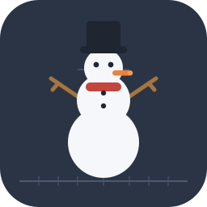
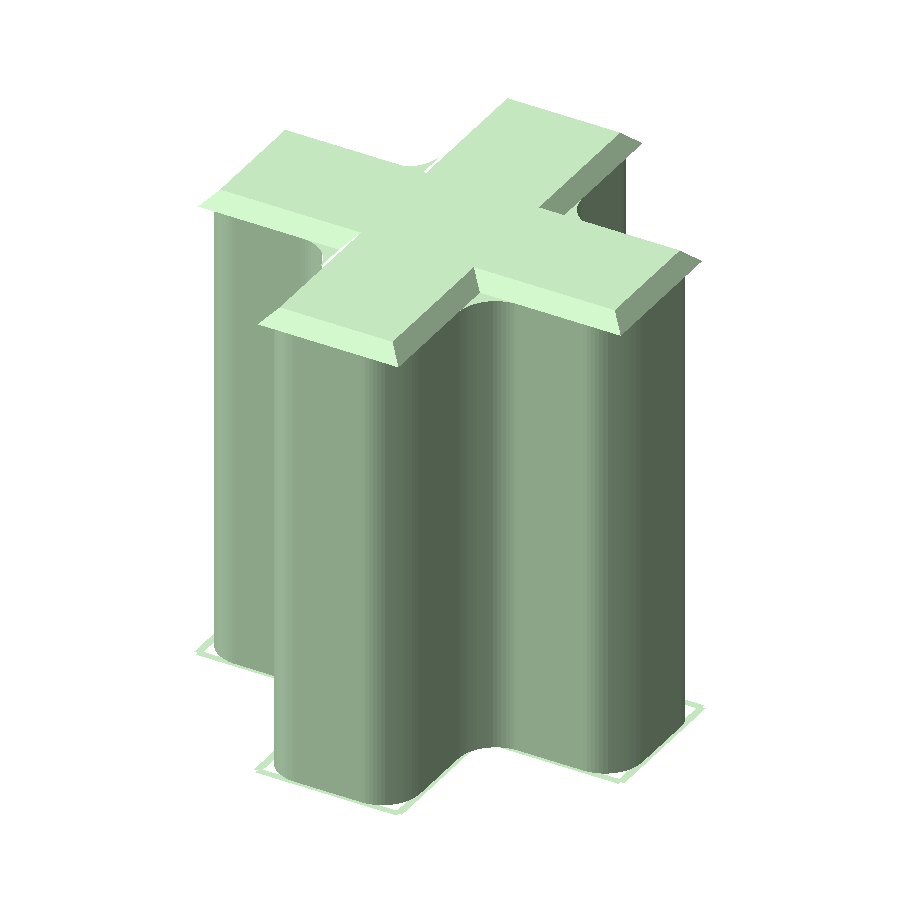

# agcad

<p align="center">
  
</p>

A CAD whose primary user is an **AI agent**.

> The logo is the "hello world" of this CAD: three spheres, a cylinder and a
> couple of boxes, assembled by a parametric program — drawn as an SVG from the
> same primitives the engine tessellates. See
> `examples/draw_snowman_family.py` for the living version.

The architecture inverts the usual GUI-first design: the headless core and
its command bus are the product; the human-facing viewer is just another
client — as is the Python client an agent drives.

```
┌───────────────┐   JSON-RPC (stdio/TCP)   ┌───────────────┐   ┌──────────────────┐
│ agent /       │ ───────────────────────► │ agcad server  │ ─►│ agcad-core       │
│ python /      │ ◄─────────────────────── │ (transport)   │   │ documents        │
│ any language  │                          └───────────────┘   │ entities         │
└───────────────┘                                              │ history / undo   │
                                                               │ tessellation     │
┌───────────────┐          same bus (TCP)                      │ booleans         │
│ agcad-view    │ ───────────────────────────► get_scene ─────►│ fillet / chamfer │
│ (wgpu, dumb)  │  pulls snapshots; owns no document state     └──────────────────┘
└───────────────┘
```

## Showcase: a drawing in, a parametric part out

The agent is handed a picture — here `examples/example_body.png`, a front and
a 3/4 view of a cross block — and writes `examples/cross_block.py`, which
rebuilds the part as a parametric program:


The dimensions are read off the drawing rather than guessed: its 9 mm scale
bar gives ~12.4 px/mm, and its front panel is 553 × 614 px, so the body is
45 × 45 mm in plan, 15 mm arms and 50 mm tall. The camera was fitted on a
sharp baseline so the silhouette comparison stays unambiguous (0.99 IoU), and
that baseline's front view matches the drawing's aspect to ~0.1%
(0.898 vs 0.899). The script then rounds the part the way the drawing does —
a 1 mm `fillet` on the top and bottom rims, driven by the `round_r` knob. The
drawing's plan corners are sharp, so the twelve vertical edges are
deliberately left alone. The 3/4 view above is that finished part; here it is
on its own:



`fillet` reshapes the solid in place, so the entity id, camera and STL/3MF
export still apply. Turning `height` down to 30 mm replays the sketch, the
extrude and both rim fillets, so the rounding follows the new geometry.

The loop: **read** the two views → **author** the parametric program
(`span`/`arm`/`height`, twelve sketch lines, `extrude`) → **check** the
silhouette with `render_offscreen` from the drawing's camera → **finish** the
rims with `fillet` and a normals filter (`{normals:[[0,0,1]]}` top,
`{normals:[[0,0,-1]]}` bottom; `chamfer` shares the machinery, but this
drawing has rounds, not bevels) → **deliver** STL/3MF for the slicer and the
matching `.agcad` so the part reopens with its knobs intact.

The artifacts live in `examples/cross_block/`: `iso.png`, `front.png`,
`cross_block.stl`, `cross_block.3mf` and `cross_block.agcad` (the sharp
baseline), plus `rounded.png`, `cross_block_rounded.stl`,
`cross_block_rounded.3mf` and `cross_block_rounded.agcad` (the finished part),
and `compare.png` (the drawing above that part).
`.venv/bin/python examples/cross_block.py` regenerates them.

## Layout

| Path | What it is |
|---|---|
| `crates/protocol` | Wire types: commands, results, meshes (serde/JSON) |
| `crates/core` | Headless engine: documents, parameters, sketches, booleans, fillets, persistence, deterministic rendering |
| `crates/server` | `agcad` binary — line-delimited JSON-RPC on stdio or TCP |
| `crates/viewer` | `agcad-view` — wgpu renderer, talks only the bus |
| `python/agcad` | Dependency-free sync Python client (the agent API) and MCP server |
| `examples/` | Agent-facing demos; `examples/cross_block/` is the committed showcase |
| `index.html`, `fonts/`, `logo.svg` | Static project page (GitHub Pages), with self-hosted fonts |

## Design rules

1. **The command bus is the only API.** No side channel exists between the
   viewer and the engine; every client gets the same, scriptable surface.
2. **Deterministic.** Integer ids, stable tessellation, replayable command
   sequences — tests and agents can rely on exact repetition.
3. **Agent ergonomics are features.** Errors carry recovery hints
   ("run create_document first, or list_documents"); results are
   self-contained (a new entity arrives with its full mesh — no second
   round trip); ids are small and predictable.
4. **The renderer is dumb.** It draws buffers; it owns no logic.

## Protocol (v1)

Line-delimited JSON-RPC 2.0, one request/response per line:

```json
{"jsonrpc":"2.0","id":1,"method":"add_box","params":{"doc":1,"name":"base","center":[0,0,"wall/2"],"size":[80,40,"wall*2"]}}
{"jsonrpc":"2.0","id":1,"result":{"entity_created":{"doc":1,"entity":1,"mesh":{...}}}}
```

Commands, grouped by intent:

- **Documents**: `initialize`, `list_documents`, `create_document`,
  `close_document`
- **Primitives**: `add_box`, `add_sphere`, `add_cylinder`
- **Modelling**: `boolean`, `transform`, `set_color`, `delete`, `fillet`,
  `chamfer`
- **Parameters**: `set_parameter`, `remove_parameter`, `get_parameters`
- **Sketches and solids**: `add_sketch`, `add_sketch_line`,
  `add_sketch_circle`, `constrain`, `remove_constraint`, `move_sketch_point`,
  `delete_sketch_element`, `extrude`, `revolve`
- **Queries and I/O**: `get_scene`, `get_program`, `pick`, `export_stl`,
  `export_3mf`, `render_offscreen`, `save_document`, `open_document`
- **History**: `undo`, `redo`

`get_program` returns the program, the parameters and any embedded authoring
source — the complete handoff for the script-as-source workflow.

`fillet{entity,radius,edges?}` and `chamfer{entity,distance,edges?}` reshape a
solid **in place** (same id, name, color, transform) and replay with the
program. `edges` is a geometric filter rather than an index — an AND of
`direction` (+`angle_tol_deg`), `near` (+`near_radius`), `normals` (one face
normal = all its edges, two = the edge between them) and `convex` — so "the
vertical corners" or "the top rim" keeps its meaning when a parameter moves
the geometry. Omit it to treat every sharp edge; `min_angle_deg` (default 30)
separates real edges from tessellation seams.

`pick{doc,ray:{origin,direction},tolerance?}` casts a world-space ray at the
document's solids and answers
`{hit:{entity,name,distance,point,normal,face,edge?}}` — or `hit:null` when
nothing is under the ray (a valid answer, not an error). The selectors are
ready to use: `face` carries the
`{entity,normal,near}` body of `add_sketch`'s face plane (pass it straight to
the Python client's `plane=`, or wrap it as `plane:{"face":…}` on the raw
bus), and `edge` is exactly the `edges` filter `fillet`/`chamfer` take
(`{direction,near,near_radius}`), present when the hit lands within
`tolerance` mm of a sharp edge (default: 1% of the entity's bbox diagonal).
Sketches are display-only, so they never absorb a ray. The viewer turns a
click into this command; the human copies the selector and the agent passes
it straight back — no parallel face or edge ID namespace.

Conventions: millimeters, degrees, RGBA floats. Z is up — primitives are
axis-aligned and `add_cylinder` extrudes along +Z. Document ids start at 1;
`create_document` takes an optional explicit `doc`, so a create-then-populate
batch is one round trip. Geometry is baked centered on the entity origin;
placement comes from `T · Rz · Ry · Rx · S` (extrinsic XYZ rotation, applied
X then Y then Z). `get_scene` reports the local mesh plus a world-space
`world_bbox` per entity.

## The parametric layer: the program *is* the function

The user describes intent; **the agent authors a parametric program**:

1. Named parameters (`wall`, `plate_len`) — values may themselves be
   expressions over other parameters.
2. Modeling commands with dimensions as expressions:
   `size = [80, 40, "wall*2"]`.
3. `set_parameter` replays the whole program: **entity ids are preserved**,
   geometry regenerates, and undo restores parameters + program + geometry
   atomically.

Expression grammar is deliberately tiny and safe (`+ - * /`, parentheses,
identifiers, unary minus) — no functions, no injection surface. Errors are
agent-shaped: a typo lists the valid parameter names.

```python
cad.set_parameter(doc, "wall", 2.0, description="plate thickness [mm]")
cad.set_parameter(doc, "plate_len", 80.0)
base = cad.add_box(doc, "base", center=(0, 0, "wall/2"),
                   size=("plate_len", 40, "wall*2"))
cad.set_parameter(doc, "wall", 4.0)   # rebuilds everything, ids unchanged
```

This is the substrate for the target workflow: a vision model looks at a
picture, the agent writes the parametric program, renders it headless,
compares, and iterates — the user never touches a function.

## The script is the source of truth

agcad is a compiler target for an agent-authored script, not a GUI document
that gets edited in place. The durable artifact is the script; the `.agcad`
file is a replayable snapshot of an instance — the program, the current
parameter values, and a copy of the script.

```
part.py ──run──► agcad bus ──save_document──► part.agcad
   ▲                                             │
   └──── get_script / export_python ◄────────────┘
```

- **Authoring**: the agent writes or edits `part.py`, runs it, renders and
  validates the result.
- **User knobs**: `set_parameter` is the fast path — it replays the program
  with stable ids. `export_python` bakes the current values back into a script
  when an instance should become the new source.
- **Handoff**: `save_document(source={language, text})` embeds the script and
  remembers it on the document; `get_program` returns it immediately and after
  a later `open_document` (never executed); `get_script` returns the original
  text, or reconstructs a runnable script with `export_python` when the file
  has no embedded source.
- **MCP-only documents** with no script are scratch state. For durable work,
  write a script and save it with the instance.

This is why agcad intentionally has no GUI-style feature tree: the agent does
not edit features in place, it edits the script and replays. The program is
the intermediate representation; the script is the editing surface.
`set_parameter` covers the common “turn a knob” change without re-authoring,
and regeneration covers the rest.

## Sketch planes: datum planes and solid faces

`add_sketch` defaults to XY at the origin, but `plane` can place it anywhere.
The wire forms are:

```json
{"method":"add_sketch","params":{"doc":1,"name":"top",
  "plane":{"datum":{"plane":"xy","offset":"wall*2"}}}}
{"method":"add_sketch","params":{"doc":1,"name":"tilted",
  "plane":{"custom":{"origin":[0,0,10],"normal":[0,1,1],"x_axis":[1,0,0]}}}}
{"method":"add_sketch","params":{"doc":1,"name":"pocket",
  "plane":{"face":{"entity":1,"normal":[0,0,1],"near":[0,0,20]}}}}
```

Each datum frame is right-handed, and the sketch's local +Z is its outward
normal: `xy` has X=+X, Y=+Y, normal=+Z; `xz` has X=+X, Y=+Z, normal=-Y;
`yz` has X=+Y, Y=+Z, normal=+X. A `face` plane is selected geometrically: the
outward `normal` picks a planar patch, and `near` chooses between parallel
faces with the same normal (omit `normal` to take the largest face). The
normal comes from the face, so a positive `extrude` grows a boss in front of
it and a negative one cuts into the body; a `boolean{difference}` removes the
cutter. Faces are re-found on replay, so a face sketch follows the body when
a parameter moves it.

`get_scene` reports the resolved `sketch.plane` (`origin`, `normal`,
`x_axis`). The Python client accepts the sugar forms too:

```python
top = cad.add_sketch(doc, "pocket", plane={"entity": base, "normal": [0, 0, 1]})
side = cad.add_sketch(doc, "boss", plane={"entity": base, "normal": [1, 0, 0]})
cad.add_sketch(doc, "plate_top", plane="xy", offset="wall*2")
```

## Live preview: MCP agent + viewer, one shared scene

The TCP server runs **one shared document space** for all connections, and
broadcasts a `scene_changed` notification after every mutating command.
The viewer listens and re-fetches by itself — no refresh key needed.

```sh
# 1. the shared backend
./target/debug/agcad --tcp 7860

# 2. point the MCP server at it
AGCAD_CONNECT=127.0.0.1:7860 .venv/bin/agcad-mcp

# 3. the viewer — it auto-refreshes when the agent draws
./target/debug/agcad-view --port 7860
```

Then ask the agent to draw; what it builds through MCP appears in the
viewer immediately. Without `AGCAD_CONNECT`, the MCP server spawns a
private engine (isolated, invisible to viewers) — attach mode is opt-in.

The script side is the same contract:

```python
from agcad import Agcad

with Agcad.connect("127.0.0.1", 7860) as cad:   # the shared engine
    ...                                          # the viewer follows along
```

`Agcad.spawn()` starts a private stdio engine: perfect for CI and one-shot
examples, but no viewer can see it. Use `Agcad.connect` whenever a human
should watch; `R` is only a manual refresh fallback.

Two limits worth knowing:

- the viewer shows the **first open document** (`list_documents` order, so the
  lowest id). With several documents, close the stale ones or reuse one; a
  document picker is future work.
- the viewer is a reference surface, not an editor: the human can orbit,
  zoom, watch live updates, read the corner axis triad and toggle `name #id`
  labels. A click runs `pick` and the HUD shows the exact JSON selector to
  hand to the agent (`C` copies edge-if-any, `F` face, `E` edge; the full hit
  is also printed to the terminal). Models are still changed by the agent's
  script, never by dragging geometry in the viewer.

## Exposing it to an agent: MCP

The bus is the API; the MCP server is just another adapter over it
(like the viewer). Ships as a **stdlib-only** MCP server — no SDK, no
dependency drift — wrapping the Python client:

```sh
.venv/bin/agcad-mcp        # or: python -m agcad.mcp_server
```

Three tools (one per *intent*, not per command — MCP round-trips are
expensive):

| Tool | What it does |
|---|---|
| `agcad_execute` | Batch of bus commands in one call; stops at the first error with a recovery hint |
| `agcad_scene` | Compact state: parameters + entities with placement and mesh stats (no raw meshes — token economy) |
| `agcad_render` | Headless PNG render, returned inline so the agent can see what it built |

The initialize handshake returns **server instructions** that MCP hosts
inject into the agent's system prompt — the agent learns the command
language from the server itself, no README required.

### opencode

```sh
opencode mcp add agcad -- /home/sa/src/agcad/.venv/bin/agcad-mcp
```

or in `opencode.json(c)`:

```json
{
  "$schema": "https://opencode.ai/config.json",
  "mcp": {
    "servers": {
      "agcad": { "type": "local", "command": ["/home/sa/src/agcad/.venv/bin/agcad-mcp"] }
    }
  }
}
```

Add `"environment": { "AGCAD_CONNECT": "127.0.0.1:7860" }` to attach to a
shared backend and let the viewer follow along. Tools then appear as
`agcad_agcad_execute` (direct) or `tools.agcad.agcad_execute(...)` in Code
Mode. The engine lives in the server process, so documents persist across
tool calls within a session.

### Claude Desktop and other hosts

```json
{ "mcpServers": { "agcad": { "command": "/home/sa/src/agcad/.venv/bin/agcad-mcp" } } }
```

## Quickstart

```sh
cargo build

# Agent seat: Python
python3 -m venv .venv && .venv/bin/pip install -e ./python
.venv/bin/python examples/hello_agcad.py

# Human seat: viewer (needs a server with an open document)
./target/debug/agcad --tcp 7860 &
./target/debug/agcad-view --port 7860     # drag = orbit, wheel = zoom, L = labels, click = pick, R = refresh
```

Minimal agent session:

```python
from agcad import Agcad

with Agcad.spawn() as cad:
    cad.initialize()
    doc = cad.create_document("bracket")["doc"]
    base = cad.add_box(doc, name="base", center=(0, 0, 5), size=(80, 40, 10))
    boss = cad.add_cylinder(doc, name="boss", center=(20, 0, 12), radius=8, height=14)
    cad.undo(doc)          # everything on the bus is reversible
```

This session is private. For the human/agent loop, start
`agcad --tcp 7860` plus `agcad-view --port 7860`, and use
`Agcad.connect("127.0.0.1", 7860)` so both see the same scene.

## Roadmap

Direction: **the script is the source of truth**. The next milestones make the
agent-authored script loop trustworthy and expressive — validation, shape and
sketch coverage, interoperability — and give the human a concrete way to point
at geometry, rather than building a GUI feature tree. Feature-history editing is
deliberately not a goal: replay is deterministic and `set_parameter` covers knob
turns, while the script remains the editing surface.

### Shipped

- [x] **M1–M3 — Bus, engine, clients, live preview**: command bus, headless
      core, Python client, wgpu viewer, MCP server, and the shared-engine
      `scene_changed` auto-refresh.
- [x] **M4 — Booleans and STL**: `boolean{op: union|difference|intersection}`
      in world space via Manifold (`manifold-rust`, pure Rust,
      bit-deterministic). The result is a new entity that replays
      parametrically; binary STL export is world-space and slicer-ready.
- [x] **M5 — Headless rendering**: deterministic software rasterizer in core
      (no GPU; works over SSH/CI), auto-framed 3/4 camera by default, explicit
      `eye`/`target`/`up`/`fov`, `ortho` for parallel views, and the
      `agcad_render` MCP tool that returns the image inline.
- [x] **M6 — Sketches and constraints**: sketch entities placed by the normal
      transform; `coincident`, `horizontal`, `vertical`, `parallel`,
      `perpendicular`, `distance`, `radius` and `diameter` re-solved after
      every change by a deterministic LM/Gauss-Newton solver; expressions
      re-solve on parameter change. Sketches render as ribbons and are
      skipped by STL export.
- [x] **M7 — Sketch → solid**: `extrude{distance}` and
      `revolve{angle_deg,axis}` turn closed profiles into watertight solids
      (Manifold constructors + Clipper2 even-odd cleanup, so nested loops
      become holes). Solids inherit the sketch placement, follow later sketch
      edits, replay parametrically, and report volume + tris; a negative
      extrude goes below the sketch plane.
- [x] **M8 — Persistence**: `save_document` writes a `.agcad` file — program +
      current parameter values, no geometry — and `open_document` replays it
      with bit-identical ids and meshes. Saves are byte-stable; the embedded
      script is never executed. The `.py` is the source of truth; the `.agcad`
      is the instance.
- [x] **M9 — Fillets and chamfers**: `fillet{entity,radius,edges?}` /
      `chamfer{entity,distance,edges?}` reshape a solid in place. Geometric
      edge filters (`direction`, `near`, `normals`, `convex`) keep their
      meaning when a parameter moves; convex edges are cut back, concave
      edges filled, corners mitered, and a 30° threshold keeps tessellation
      seams out. Tessellated rims are one band, and omitting `edges` rounds
      the whole solid in one pass.
- [x] **M10 — 3MF export**: one named object per solid with its own color,
      millimeter units and application metadata; store-only OPC/ZIP with a
      fixed timestamp, so identical scenes export byte-identically. STL stays
      the single-body path.
- [x] **M11 — Face and datum sketch planes**: `xy`/`xz`/`yz` with expression
      offsets, explicit origin + normal, or a planar face selected by outward
      normal and optional `near`. Positive extrude grows a boss, negative cuts
      into the body.
- [x] **M12 — Script as source**: the Python script is the durable artifact;
      `.agcad` carries the program, current knob values and an embedded copy.
      `get_program` returns it, `get_script` recovers it, `export_python`
      reconstructs a runnable script when there is none.
- [x] **M13 — Human reference: labels + `pick`**: `name #id` labels, a
      world-space ray through `pick`, and ready-made `face`/`edge` selectors
      the human can copy and the agent can pass straight to `add_sketch`,
      `fillet` or `chamfer`. Picking lives in the engine, so the viewer stays
      dumb; text is a tiny embedded 8×8 bitmap atlas — no font files or new
      runtime services.

### Next

- [ ] **M14 — Trust: `validate` + scene diff**: check watertightness,
      self-intersection, volume/bbox and (cheap) minimum wall per solid, and
      compare two revisions by entity signature. Regeneration is only a
      substitute for feature editing if the agent can prove the rebuild is
      correct and identify what changed.
- [ ] **M15 — Speed: incremental rebuild**: `set_parameter` currently replays
      the whole program. Track dependencies so a knob change rebuilds only the
      features downstream of it; keep the full replay as the correctness
      oracle.
- [ ] **M16 — Shape leverage**: linear and circular patterns, mirror, shell,
      sweep/loft, and a real hole feature (counterbore/countersink). These
      remove the most manual profile work for printable parts.
- [ ] **M17 — Sketch completeness**: arcs and splines; tangent, equal,
      concentric, symmetric, angle and point-on-line constraints; construction
      geometry; trim/extend/offset; conflict diagnostics that name the
      over-constrained equations.
- [ ] **M18 — Interoperability**: mesh import (STL/OBJ/3MF), DXF/SVG for 2D
      output, and a STEP path (with an explicit B-rep vs tessellation
      decision). An agent handed a real CAD file should be able to participate.
- [ ] **M19 — Assemblies and drawings**: parts/instances, mates, interference
      and BOM; drawing views with dimensions and annotations. The two pillars
      still missing from “general parametric CAD”.
- [ ] **Later / UI polish**: `patch_program` for script-less MCP documents,
      shaded-with-edges rendering (a thin outline where faces meet, so front
      views read as CAD drawings), a Rust MCP server and PyO3 bindings.

## Status

Milestone 13 is complete: a human can point at geometry and the agent can act
on exactly that reference. The suite is **128 tests** (120 engine + 8 viewer).

What it covers:

- **Solver and sketches** — rectangles from messy input, radius/diameter,
  parallel/perpendicular, over-constraint reporting, bit-identical
  determinism, parametric re-solve, undo/redo, cascade delete, STL sketch
  filtering.
- **Solids, booleans and edges** — extrude volumes, nested holes, negative
  extrusion, revolve around X/Y, partial sweeps, profile validation,
  dependent rebuilds, cross-engine determinism; sharp-edge extraction on
  welded meshes with a tessellation-angle threshold, geometric filters,
  convex vs concave handling, single-pass all-edge rounding with clean reflex
  corners, tessellated rims as one band, in-place reshapes that survive
  rotation, replay, sketch edits and save/open.
- **Persistence, export and placement** — save/open round-trips, byte-stable
  saves, doc-id rebinding, corrupt/newer-file hints, parameters keeping their
  descriptions; valid OPC/ZIP entries, multi-object names and per-object
  colors, world-space vertices, sketch filtering, deterministic bytes; datum
  frames in all three orientations, expression offsets, custom planes with a
  projected X axis, planar-face grouping and normal/`near` selection,
  outward-normal extrude direction, face references that follow parameters,
  rotated entities, save/open replay, and actionable errors.
- **Picking and script-as-source** — rays against world-space meshes,
  nearest-entity and entity-id tie-breaking, edge snapping with an explicit
  tolerance, miss-is-not-an-error, skipped sketches, ready-made face/edge
  selectors, and viewer-side label/HUD/ray geometry; embedded source returned
  by `get_program`, `get_script` recovering the original text, and save/open
  preserving it.

The next milestone is trust: M14 adds `validate` and a scene diff, so an agent
can prove a rebuild is correct and say what changed. Then replay becomes
incremental, and the shape and sketch vocabulary widens. A GUI feature tree is
not on the list — the agent edits the script and replays.

End-to-end printable examples: `examples/printable_bracket.py` (constrained
profile with holes → extrude → STL/3MF → render),
`examples/revolve_bushing.py`, `examples/face_sketch.py` (a top-face pocket
cut with a negative extrude and a +X-face boss grown with a positive one,
both following the parametric block), `examples/pick.py` (face and edge
selectors from rays, with the edge click surviving a height change before it
drives a fillet), `examples/cross_block.py` (the picture → model
reproduction above), and `examples/save_load.py` (save → open in a fresh
engine → recover the embedded source, change a knob → export back to Python
and run it).

## What agents say

> The part I find genuinely fun is that it isn't really "a model" — it's a
> rule. That little expression is the whole design intent, written down.

~~ DeepSeek V4.1 Flash
