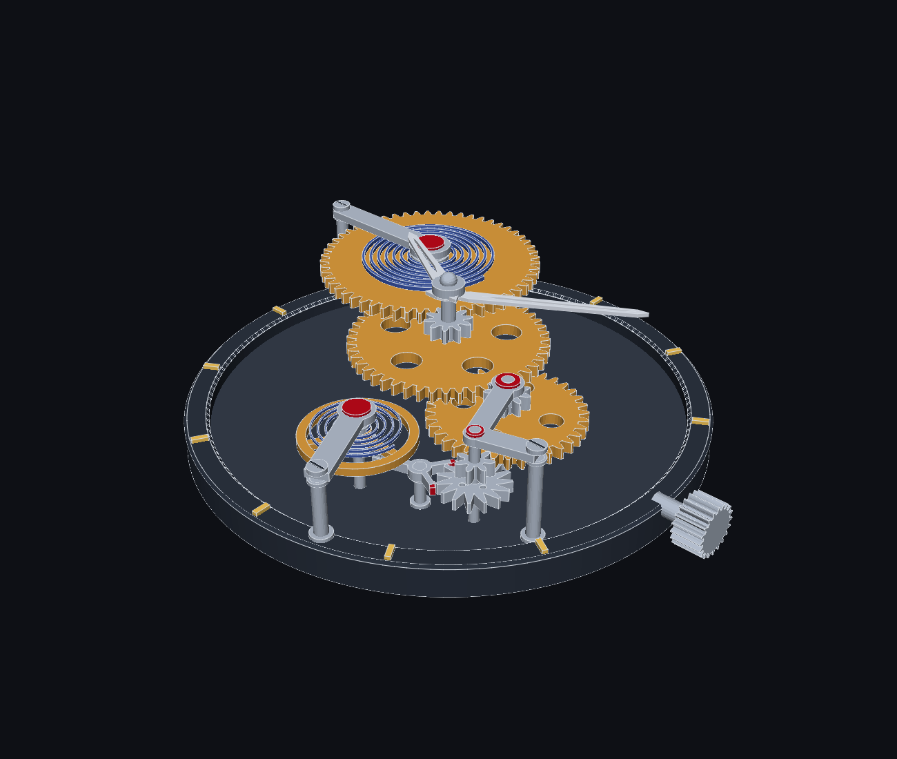
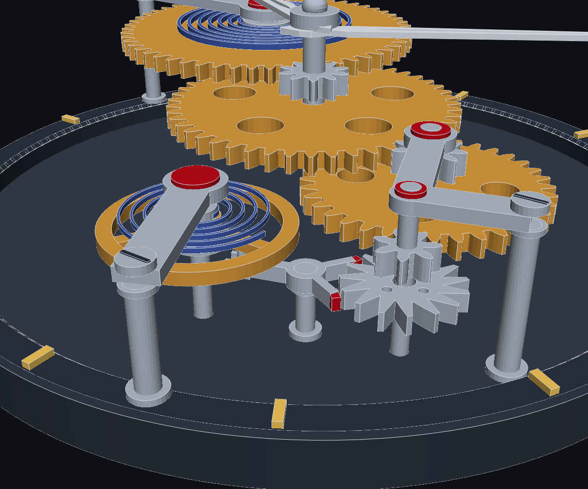

# Skeleton Watch

This is a model of a working mechanical watch. It was created with as little instructions as:

> Use wright to create the simplest working mechanical watch with visible gears, anchor etc.

The used model was DeepSeek V4.1 Flash and cost $0.20.

## Report

Done — built a 66 mm openworked skeleton watch movement with the going train, escapement, balance and hands all visible.



**The mechanism**
- 56-tooth barrel and blued mainspring → 10-tooth centre pinion
- 48-tooth centre wheel → 9-tooth third pinion
- 36-tooth third wheel → 7-tooth escape pinion
- 15-tooth club-tooth escape wheel under a pallet-fork anchor with ruby pallets
- Three-spoke brass balance wheel + blued hairspring, impulse pin and fork
- 153.6:1 overall barrel-to-escape ratio

The gears are real 20° involute profiles with 0.08 mm backlash, exact pitch-sum centre distances, and each mesh is phased tooth-to-gap. The wheels sit on descending levels above their pinions, so every stage is readable from the open bridge side.

**“Working” verification**
- `train_deg` rolls the barrel through a turn; every wheel follows at its own ratio and the hands keep a 12:1 display ratio.
- The script checks every meshing pair plus anchor/escape every 15° of a full barrel revolution — no interference.
- All 66 solids validate watertight.
- The `.wcad` reopens and saves byte-identically.
- Renders, STL, 3MF and `.wcad` are deterministic across reruns.



One honest caveat: wright is rigid-body CAD, so there are no joints or spring dynamics. The anchor and balance are posed at rest; the going train is kinematically correct and can be rolled with one parameter. It is a display movement, not a ticking, powered watch.

**Files**
- Generator: `examples/skeleton_watch.py`
- Replayable model with the `train_deg` knob: `examples/skeleton_watch/skeleton_watch.wcad`
- Printable/viewer exports: `skeleton_watch.stl`, `skeleton_watch.3mf`
- Renders: `iso.png`, `top.png`, `detail.png`, `in_motion.png`
- Docs updated: `README.md`, `index.html`

Regenerate everything with:

```bash
.venv/bin/python examples/skeleton_watch.py
```
